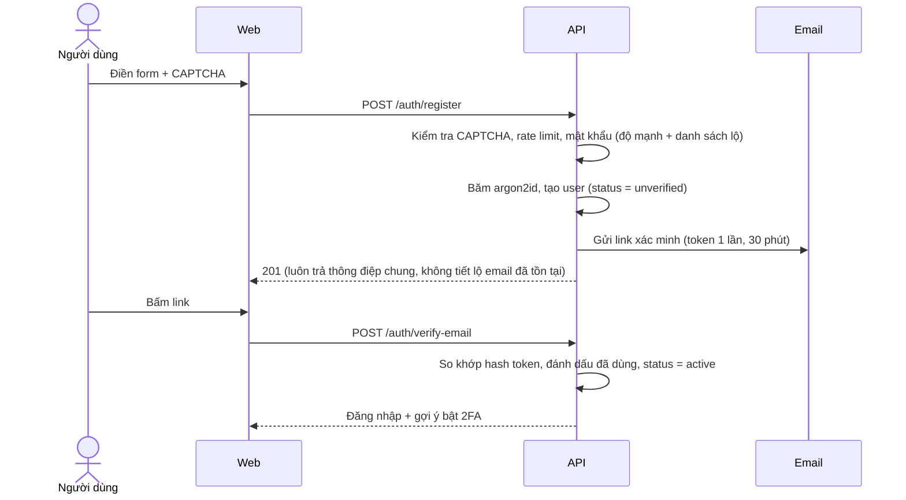
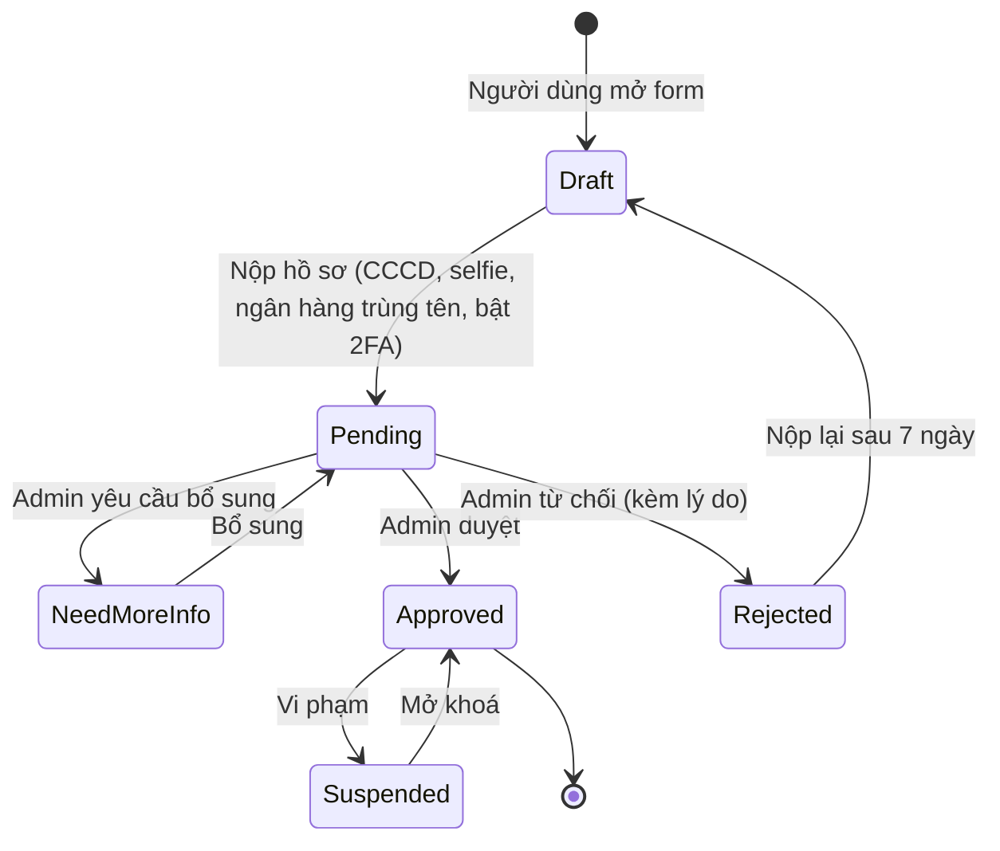
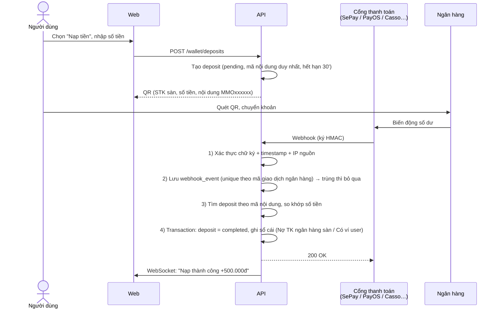
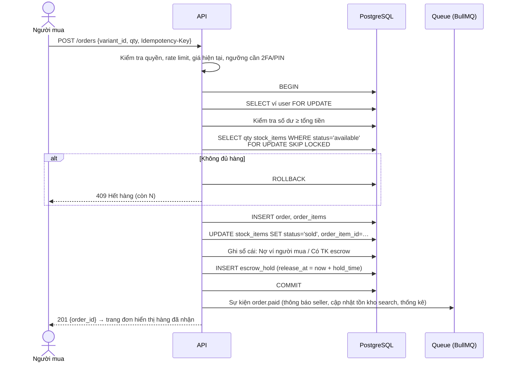
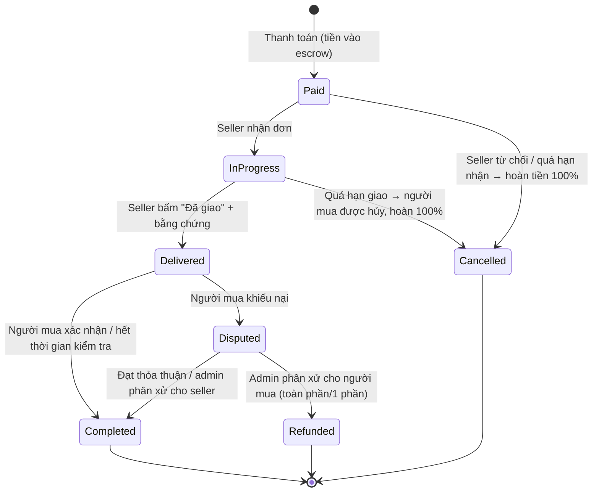
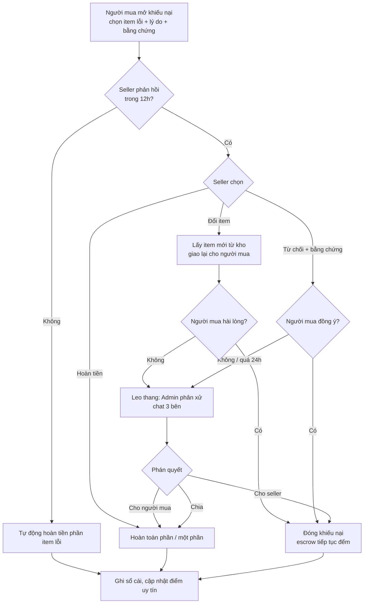
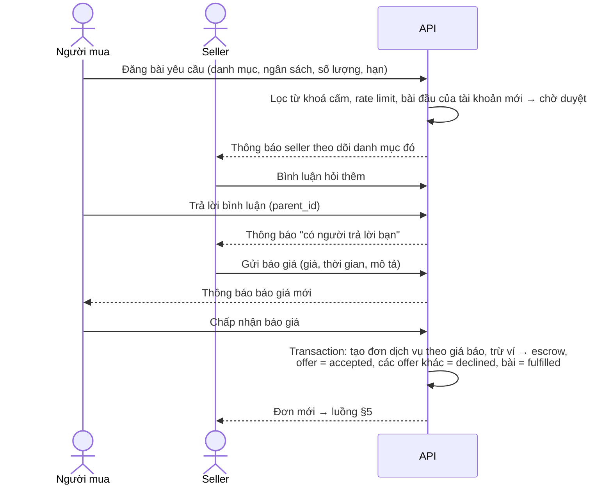
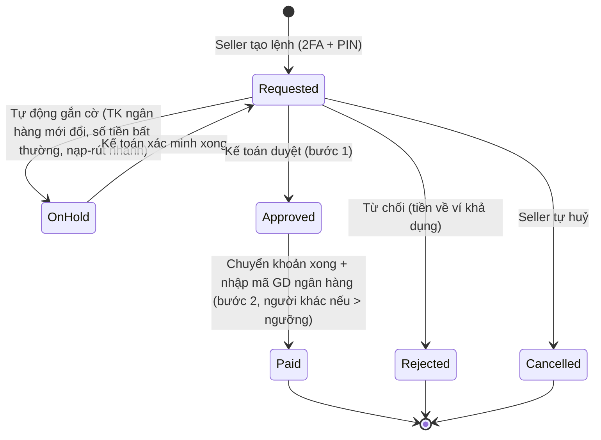
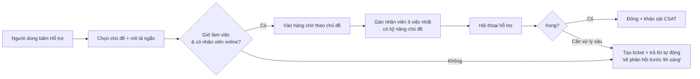

# 03. Luồng nghiệp vụ

Các sơ đồ dùng Mermaid, GitHub tự hiển thị.

---

## 1. Đăng ký và xác minh



## 2. Đăng ký người bán (KYC)



**Quy tắc**
- Bắt buộc bật 2FA trước khi nộp.
- Ảnh KYC lưu ở bucket riêng tư, mã hoá, chỉ người có quyền `kyc.view` xem được, mỗi lần xem ghi audit log.
- Kiểm tra trùng: 1 CCCD chỉ gắn với 1 gian hàng; tài khoản ngân hàng đã dùng ở gian hàng bị khoá thì gắn cờ.
- Seller mới vào cấp **"Mới"**: sản phẩm phải duyệt, thời gian giữ tiền dài hơn, hạn mức rút thấp hơn.

## 3. Nạp tiền qua VietQR (tự động)



**Xử lý ngoại lệ**

| Tình huống | Cách xử lý |
|-----------|-----------|
| Chuyển sai nội dung | Giao dịch vào hàng chờ "Chưa khớp". Người dùng gửi yêu cầu kèm biên lai. Kế toán khớp thủ công (2 bước) |
| Chuyển khác số tiền | Cộng đúng số thực nhận, ghi chú. Hoặc vào hàng chờ nếu lệch quá ngưỡng cấu hình |
| Webhook đến 2 lần | Ràng buộc unique `provider + provider_txn_id` nên lần 2 bị bỏ qua |
| Webhook không đến | Job đối soát mỗi 5 phút gọi API lịch sử giao dịch của cổng để bù |
| Deposit hết hạn mà tiền vẫn về | Vẫn khớp theo mã nội dung nếu mã chưa dùng. Mã không tái sử dụng |

## 4. Mua hàng giao tự động (luồng quan trọng nhất)



**Điểm then chốt**
- `FOR UPDATE SKIP LOCKED` cho phép nhiều người mua cùng lúc mà **không bao giờ bán trùng 1 item**.
- Khoá ví bằng `FOR UPDATE` và ràng buộc `CHECK (balance >= 0)` nên **không thể chi vượt số dư** khi gửi nhiều request song song.
- `Idempotency-Key` (UUID do client sinh): người dùng bấm 2 lần hay mạng chập chờn thì cũng chỉ tạo 1 đơn.
- Hàng chỉ được giải mã khi người mua mở trang đơn (`GET /orders/:id/items`). Mỗi lần xem ghi log.

## 5. Đơn dịch vụ (giao thủ công)



## 6. Trạng thái đơn hàng (chung) và giải ngân escrow

| Trạng thái | Ý nghĩa | Tiền ở đâu |
|-----------|---------|-----------|
| `paid` | Đã thanh toán | Escrow |
| `in_progress` | (Dịch vụ) seller đang làm | Escrow |
| `delivered` | Đã giao, đang trong thời gian bảo hành/kiểm tra | Escrow |
| `disputed` | Đang khiếu nại, **ngừng đồng hồ giải ngân** | Escrow (đóng băng) |
| `completed` | Hoàn tất | Đã chuyển seller (trừ phí) |
| `refunded` / `partially_refunded` | Hoàn tiền | Về ví người mua (và một phần cho seller nếu hoàn 1 phần) |
| `cancelled` | Huỷ trước khi giao | Về ví người mua |

**Thời gian giữ tiền** = `max(bảo hành của sản phẩm, hold tối thiểu theo cấp seller)`. Ví dụ cấu hình:

| Cấp seller | Hold tối thiểu | Hạn mức rút/ngày | Duyệt sản phẩm |
|-----------|---------------|------------------|----------------|
| Mới | 72 giờ | 5 triệu | Thủ công |
| Đồng | 48 giờ | 20 triệu | Thủ công (lấy mẫu) |
| Bạc | 24 giờ | 50 triệu | Tự động + hậu kiểm |
| Vàng | 12 giờ | 200 triệu | Tự động + hậu kiểm |
| Kim cương | 6 giờ | Theo thỏa thuận | Tự động + hậu kiểm |

**Job giải ngân** (chạy mỗi phút, có khoá phân tán để chỉ 1 worker chạy):
```
SELECT … FROM escrow_holds
WHERE status='holding' AND release_at <= now()
  AND order không có dispute mở
FOR UPDATE SKIP LOCKED LIMIT 500
→ với mỗi hold, trong 1 transaction:
   Nợ TK escrow (tổng) / Có ví seller (tổng - phí) / Có TK doanh thu sàn (phí)
   hold.status = 'released'; order.status = 'completed'
```

## 7. Khiếu nại



**Quy tắc**
- Chỉ mở được khiếu nại khi đơn chưa `completed` và còn trong thời gian bảo hành.
- Khiếu nại theo **từng item** (đơn 100 tài khoản, 3 cái lỗi thì khiếu nại 3 cái).
- Khi phân xử, admin xem nội dung item thì phải nhập lý do. Hành động được ghi audit.
- Mọi hạn (12h, 24h) là cấu hình. Đồng hồ hiển thị đếm ngược cho cả 2 bên.

## 8. Chợ yêu cầu: đăng bài, bình luận, báo giá, chốt đơn



**Cấu trúc bình luận**: lưu dạng cây (`parent_id`, `root_id`, `depth`). Giao diện hiển thị **2 cấp**:
- Cấp 1: bình luận vào bài.
- Cấp 2: các trả lời, xếp theo thời gian.
- Trả lời một trả lời: vẫn ở cấp 2, tự chèn `@tên` người được trả lời.

Cách này giữ giao diện gọn như Facebook mà vẫn biết ai trả lời ai.

## 9. Rút tiền



- Khi tạo lệnh: chuyển tiền từ ví khả dụng sang trạng thái "chờ rút" (bút toán), tránh bị tiêu 2 lần.
- Chỉ rút về tài khoản ngân hàng **trùng tên KYC**.
- Đổi hoặc thêm tài khoản ngân hàng thì khoá rút 48 giờ và gửi email cảnh báo.
- Lệnh vượt ngưỡng (ví dụ 50 triệu) cần **2 nhân sự khác nhau** duyệt.

## 10. Chat hỗ trợ



- Hội thoại hỗ trợ tự **đính kèm ngữ cảnh**: mã đơn/giao dịch gần nhất, trạng thái tài khoản. Nhân viên thấy ở cột phải.
- Người dùng **không bao giờ** thấy tên đăng nhập thật của nhân viên, chỉ thấy tên hiển thị như "Hỗ trợ viên Lan".
- Hệ thống luôn hiển thị nhắc nhở: **"Nhân viên không bao giờ hỏi mật khẩu, mã 2FA hay yêu cầu chuyển khoản riêng."**

## 11. Báo cáo vi phạm và kiểm duyệt

1. Người dùng bấm "Báo cáo" trên sản phẩm, bài, bình luận, tin nhắn, người dùng hoặc gian hàng, rồi chọn lý do.
2. Báo cáo vào hàng chờ của mod, gom các báo cáo trùng đối tượng. Từ N báo cáo trở lên thì tự ẩn tạm thời.
3. Mod xử lý: bỏ qua / ẩn / xoá / cảnh cáo / khoá tạm / khoá vĩnh viễn / giữ tiền (cần quyền admin).
4. Người bị xử lý nhận thông báo kèm lý do và có thể kháng nghị 1 lần.
