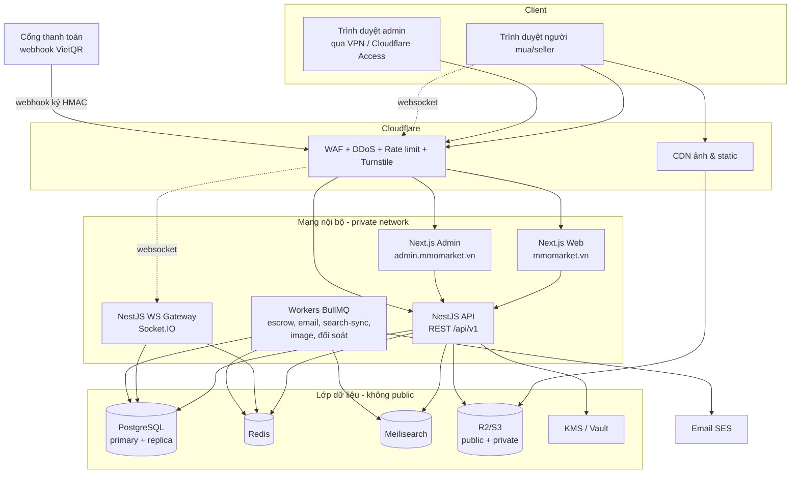
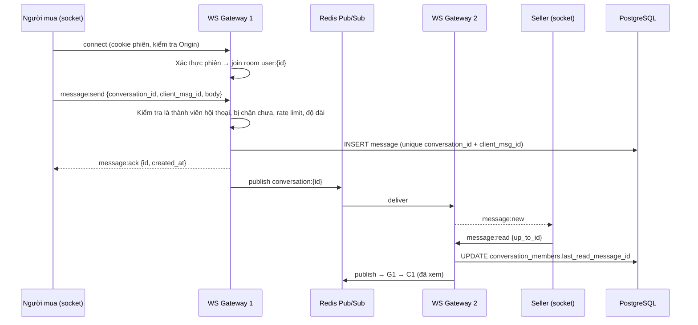

# 04. Kiến trúc và công nghệ

## 1. Lựa chọn công nghệ (khuyến nghị)

| Lớp | Công nghệ | Lý do |
|-----|-----------|-------|
| Ngôn ngữ | **TypeScript** toàn bộ (front + back) | Một ngôn ngữ, chia sẻ schema/kiểu dữ liệu, dễ tuyển người |
| Web người dùng + Seller Center | **Next.js** (App Router, React Server Components) | SSR/SSG cho SEO trang sản phẩm/danh mục, tốc độ tải tốt |
| Admin | **Next.js app riêng** (hoặc Vite + React SPA) trên subdomain riêng | Tách biệt build, cookie và network policy khỏi web công khai |
| UI | **Tailwind CSS + shadcn/ui** (Radix), icon **Lucide** | Component đẹp, truy cập tốt (a11y), dễ làm dark mode |
| Biểu đồ dashboard | **Recharts** (hoặc Tremor, dựng trên Recharts) | Đủ cho line/bar/area/donut/heatmap, nhẹ |
| Bảng dữ liệu admin | **TanStack Table** | Sắp xếp, lọc, phân trang server-side, chọn hàng loạt |
| Form & validate | **React Hook Form + Zod** | Dùng chung schema Zod ở cả client và server |
| Data fetching | **TanStack Query** | Cache, refetch, optimistic update |
| Backend API | **NestJS** (modular monolith) | Cấu trúc module rõ, DI, guard/interceptor cho auth và phân quyền |
| ORM | **Prisma** | Type-safe, migration tốt. Raw SQL chỗ cần `FOR UPDATE SKIP LOCKED` (luôn tham số hoá) |
| CSDL | **PostgreSQL 16+** | Transaction mạnh, row lock, JSONB cho thuộc tính, partition cho log |
| Cache / session / rate-limit / pub-sub | **Redis 7** | Phiên đăng nhập, đếm rate limit, Socket.IO adapter, khoá phân tán |
| Hàng đợi job | **BullMQ** (dùng Redis) | Giải ngân escrow, gửi email, đồng bộ search, xử lý ảnh, đối soát |
| Tìm kiếm & bộ lọc | **Meilisearch** | Facet (đếm kết quả bộ lọc), chịu lỗi chính tả, tìm không dấu, rất nhanh |
| Realtime | **Socket.IO** (gateway trong NestJS) + Redis adapter | Chat, thông báo, cập nhật tồn kho, scale nhiều instance |
| Lưu file | **S3-compatible**: Cloudflare R2 (hoặc MinIO tự host) | 2 bucket: `public` (ảnh sản phẩm qua CDN), `private` (KYC, chat, bằng chứng; signed URL) |
| Xử lý ảnh | **sharp** | Resize, chuyển WebP/AVIF, xoá EXIF |
| Email | Amazon SES / Resend | Rẻ, độ tin cậy cao, có DKIM/SPF/DMARC |
| CDN / WAF / DDoS / CAPTCHA | **Cloudflare** (gói Pro trở lên khi chạy thật) | Ẩn IP gốc, WAF rule, rate limit biên, Turnstile |
| Quản lý khoá mã hoá | Cloud KMS (AWS KMS / GCP KMS) hoặc **HashiCorp Vault** (Transit) | Envelope encryption cho dữ liệu hàng số và KYC |
| Giám sát | **Sentry** (lỗi), **Prometheus + Grafana** (metric), **Loki** (log), Uptime Kuma | Thấy sự cố trước người dùng |
| Hạ tầng | Docker. Giai đoạn đầu: Docker Compose trên 2–3 VPS. Khi lớn: Kubernetes (k3s) | Rẻ, đơn giản, dễ nâng cấp |
| CI/CD | GitHub Actions | Lint, test, quét bảo mật, build image, deploy |
| Monorepo | **pnpm workspaces + Turborepo** | Chia sẻ code (UI, schema, types) giữa web/admin/api |

> **Vì sao modular monolith thay vì microservices?** Đội 4–6 dev làm microservices sẽ tốn thời gian cho hạ tầng hơn là tính năng. Monolith chia module rõ ràng (mỗi module sở hữu bảng của nó, giao tiếp qua service interface hoặc event nội bộ) vẫn tách được thành service riêng sau này, ví dụ tách `chat` và `search-sync` khi tải lớn.

## 2. Sơ đồ kiến trúc tổng thể



## 3. Cấu trúc monorepo

```
mmo-market/
├── apps/
│   ├── web/                 # Next.js: trang công khai + tài khoản người mua + Seller Center (/seller/*)
│   ├── admin/               # Next.js: admin panel (deploy riêng, domain riêng)
│   ├── api/                 # NestJS: REST + WebSocket gateway
│   └── worker/              # NestJS standalone: BullMQ processors + cron
├── packages/
│   ├── ui/                  # Component dùng chung (shadcn), theme, chart wrapper
│   ├── schemas/             # Zod schema dùng chung client/server (DTO)
│   ├── db/                  # Prisma schema, migrations, seed
│   ├── config/              # eslint, tsconfig, tailwind preset
│   └── sdk/                 # API client sinh từ OpenAPI (dùng ở web & admin)
├── infra/
│   ├── docker/              # Dockerfile từng app, docker-compose.{dev,prod}.yml
│   ├── nginx/               # reverse proxy (nếu không dùng trực tiếp CF Tunnel)
│   └── monitoring/          # Grafana dashboards, Prometheus rules, alert rules
├── docs/                    # Tài liệu (bộ kế hoạch này)
└── .github/workflows/       # CI/CD
```

### Module backend (`apps/api/src/modules`)

| Module | Trách nhiệm | Bảng sở hữu chính |
|--------|-------------|-------------------|
| `auth` | Đăng ký, đăng nhập, 2FA, phiên, đặt lại mật khẩu | users, sessions, user_mfa, login_events |
| `iam` | Vai trò, quyền, policy kiểm tra quyền sở hữu | roles, permissions, role_permissions, user_roles |
| `users` | Hồ sơ, cài đặt, chặn người dùng | user_profiles, user_settings, user_blocks |
| `kyc` | Hồ sơ KYC, duyệt | seller_applications, kyc_documents |
| `stores` | Gian hàng, cấp độ, theo dõi | stores, store_followers, seller_levels |
| `catalog` | Danh mục, thuộc tính, sản phẩm, biến thể | categories, category_attributes, products, product_variants, product_attribute_values, product_images |
| `inventory` | Kho hàng số, nhập kho, mã hoá | stock_items, stock_batches |
| `search` | Đồng bộ và truy vấn Meilisearch | (index ngoài) |
| `orders` | Đặt hàng, trạng thái, giao hàng | orders, order_items, order_events |
| `escrow` | Giữ tiền, giải ngân | escrow_holds |
| `wallet` | Sổ cái, số dư, nạp, rút, ngân hàng | ledger_accounts, ledger_transactions, ledger_entries, deposits, withdrawals, bank_accounts |
| `payments` | Webhook cổng thanh toán, đối soát | payment_webhook_events |
| `disputes` | Khiếu nại, phân xử | disputes, dispute_items, dispute_events |
| `reviews` | Đánh giá, phản hồi | reviews |
| `board` | Bài yêu cầu, bình luận, báo giá | request_posts, comments, comment_reactions, offers |
| `chat` | Hội thoại, tin nhắn, hỗ trợ | conversations, conversation_members, messages, message_attachments |
| `support` | Ticket, hàng chờ hỗ trợ | support_tickets, support_queues |
| `notifications` | Thông báo đa kênh | notifications, notification_preferences |
| `moderation` | Báo cáo, từ khoá cấm, xử lý vi phạm | reports, banned_keywords, sanctions |
| `marketing` | Mã giảm giá, giới thiệu, đẩy tin | coupons, coupon_redemptions, referrals, boosts |
| `cms` | Banner, trang tĩnh, blog | banners, pages, posts |
| `analytics` | Số liệu tổng hợp cho dashboard | daily_store_stats, daily_platform_stats (materialized) |
| `audit` | Nhật ký thao tác | audit_logs |
| `settings` | Cấu hình hệ thống, công tắc khẩn cấp | system_settings |

## 4. Tìm kiếm và bộ lọc (Meilisearch)

**Index `products`** (1 document cho mỗi sản phẩm đang bán):

```json
{
  "id": "prd_01J…",
  "title": "Tài khoản Gmail cổ 2015 – đã xác minh SĐT",
  "title_unaccent": "tai khoan gmail co 2015 da xac minh sdt",
  "category_path": ["tai-khoan", "tai-khoan/email"],
  "category_id": "cat_email",
  "store": { "id": "sto_…", "name": "Shop ABC", "level": "gold" },
  "price_min": 15000, "price_max": 1200000,
  "delivery_type": "auto",
  "in_stock": true, "stock_count": 1204,
  "rating": 4.8, "rating_count": 532,
  "sold_count": 10423,
  "warranty_hours": 72,
  "attrs": { "country": "VN", "created_year": 2015, "has_2fa": true },
  "created_at": 1767225600, "boost_until": 0
}
```

- `filterableAttributes`: `category_path, delivery_type, in_stock, price_min, rating, store.level, warranty_hours, attrs.*`
- `sortableAttributes`: `price_min, sold_count, rating, created_at`
- `facets` trả về số lượng cho từng giá trị bộ lọc, dùng hiển thị "Có 2FA (1.204)".
- **Đồng bộ**: dùng outbox pattern. Mỗi thay đổi sản phẩm/tồn kho ghi 1 dòng `search_outbox` trong cùng transaction, worker đọc và đẩy sang Meilisearch (debounce 2 giây cho tồn kho). Không bao giờ để search là nguồn sự thật: giá và tồn kho luôn kiểm tra lại ở DB khi đặt hàng.
- Index thêm `stores` và `request_posts` cho tìm kiếm chung.

## 5. Realtime và chat



- **Room**: mỗi user có room `user:{id}`. Server đẩy tin vào room của từng thành viên, client không tự join room hội thoại nên không thể nghe trộm.
- **Đếm chưa đọc**: tính từ `last_read_message_id`, cache trong Redis.
- **Offline**: không có socket nào online thì tạo notification (email/Telegram tuỳ cài đặt, gộp theo 5 phút).
- **Lưu trữ**: tin nhắn giữ tối thiểu theo chính sách (ví dụ 2 năm) để làm bằng chứng khiếu nại. Bảng `messages` partition theo tháng.
- **Đính kèm**: upload qua presigned URL vào bucket private, worker quét virus và tạo thumbnail rồi mới gắn vào tin nhắn.

## 6. Hàng đợi job và tác vụ định kỳ

| Job | Lịch | Mô tả |
|-----|------|-------|
| `escrow.release` | Mỗi phút | Giải ngân escrow đến hạn |
| `dispute.auto_resolve` | Mỗi 5 phút | Quá hạn phản hồi thì tự xử lý theo quy tắc |
| `order.service_timeout` | Mỗi 5 phút | Đơn dịch vụ quá hạn nhận/giao |
| `deposit.reconcile` | Mỗi 5 phút | Đối soát với API cổng thanh toán, bù webhook thiếu |
| `deposit.expire` | Mỗi 10 phút | Hết hạn deposit pending |
| `ledger.verify` | Hằng đêm | Kiểm tra tổng Nợ = tổng Có, số dư cache = tổng bút toán. Lệch thì báo động |
| `stats.aggregate` | Mỗi 15 phút + hằng đêm | Tính số liệu dashboard seller/admin |
| `seller.level_recalc` | Hằng đêm | Tính lại cấp seller |
| `search.sync` | Liên tục (outbox) | Đồng bộ Meilisearch |
| `media.process` | Theo sự kiện | Resize ảnh, quét virus |
| `notify.dispatch` | Theo sự kiện | Gửi email/Telegram/push |
| `request_post.expire` | Mỗi giờ | Đóng bài hết hạn |
| `backup.verify` | Hằng tuần | Khôi phục thử bản sao lưu vào môi trường tạm |

## 7. Môi trường và triển khai

| Môi trường | Mục đích | Dữ liệu |
|-----------|---------|---------|
| `local` | Dev trên máy (docker-compose: pg, redis, meili, minio, mailpit) | Seed giả |
| `staging` | QA, demo, kiểm thử bảo mật | Dữ liệu giả, **không bao giờ copy dữ liệu thật** |
| `production` | Chạy thật | Thật |

**Quy trình CI/CD (GitHub Actions)**
1. PR: lint, typecheck, unit test, integration test (pg/redis trong service container), e2e Playwright các luồng chính, **quét bảo mật** (CodeQL/Semgrep, `pnpm audit`, gitleaks, Trivy cho image).
2. Merge vào `main`: build image (gắn tag commit SHA), deploy staging tự động, smoke test.
3. Release: tag `vX.Y.Z`, deploy production **thủ công có người duyệt**, migration chạy trước (chỉ migration tương thích ngược), rolling restart, rollback 1 lệnh.

**Cấu hình production giai đoạn đầu (tham khảo)**

| Máy | Cấu hình | Chạy |
|-----|----------|------|
| App 1, 2 | 4 vCPU / 8 GB | web, admin, api, ws, worker (Docker Compose) |
| DB | 4 vCPU / 16 GB / SSD NVMe | PostgreSQL primary, backup WAL liên tục ra S3 |
| Data phụ | 2 vCPU / 4 GB | Redis, Meilisearch |

Mọi máy trong private network. Chỉ nhận traffic từ Cloudflare (Cloudflare Tunnel hoặc firewall chỉ mở cho dải IP Cloudflare).
