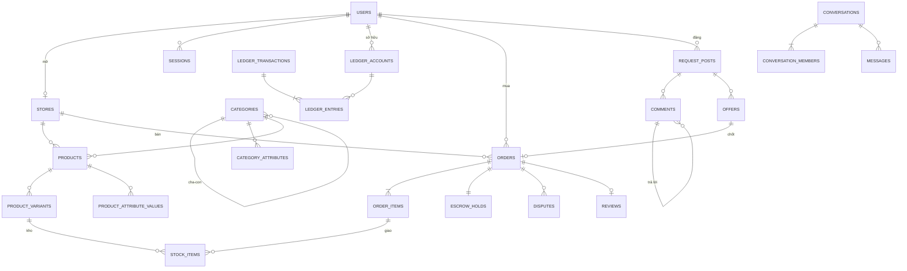

# 05. Thiết kế cơ sở dữ liệu (PostgreSQL)

## 1. Quy ước

| Quy ước | Chi tiết |
|---------|---------|
| Khoá chính | `uuid` dạng **UUIDv7** (sắp xếp theo thời gian, không đoán được, không lộ số lượng như ID tăng dần) |
| Mã hiển thị | Đơn hàng, nạp, rút có mã ngắn cho người đọc: `DH8K2M9QZ`, `NAP…`, `RUT…` (unique, ngẫu nhiên) |
| Tiền | `bigint` đơn vị **đồng** (VND không có số lẻ). **Không bao giờ dùng float** |
| Thời gian | `timestamptz`, lưu UTC, hiển thị `Asia/Ho_Chi_Minh` |
| Xoá | Xoá mềm (`deleted_at`) cho nội dung người dùng. **Không xoá** bút toán, đơn hàng, audit log |
| Trạng thái | `enum` Postgres hoặc `text` + `CHECK` |
| Cột chung | `created_at`, `updated_at`. Bảng nghiệp vụ quan trọng có thêm `version int` (optimistic locking) |
| Dữ liệu nhạy cảm | Cột mã hoá ở tầng ứng dụng có hậu tố `_enc` (`bytea`), kèm `_dek_id` hoặc gộp header |

## 2. Sơ đồ quan hệ lõi



## 3. Nhóm bảng và cột chính

### 3.1 Tài khoản và phân quyền

```sql
CREATE TABLE users (
  id               uuid PRIMARY KEY,
  email            citext UNIQUE NOT NULL,
  username         citext UNIQUE NOT NULL,
  password_hash    text NOT NULL,                 -- argon2id
  status           text NOT NULL CHECK (status IN ('unverified','active','locked','banned','deleted')),
  email_verified_at timestamptz,
  mfa_enabled      boolean NOT NULL DEFAULT false,
  txn_pin_hash     text,                          -- PIN giao dịch (argon2id)
  risk_flags       text[] NOT NULL DEFAULT '{}',  -- 'multi_account','fast_cashout',...
  last_login_at    timestamptz,
  created_at       timestamptz NOT NULL DEFAULT now(),
  updated_at       timestamptz NOT NULL DEFAULT now()
);

CREATE TABLE user_mfa (
  user_id          uuid PRIMARY KEY REFERENCES users(id),
  totp_secret_enc  bytea NOT NULL,                -- mã hoá
  recovery_codes   text[] NOT NULL,               -- hash từng mã
  enabled_at       timestamptz NOT NULL
);

CREATE TABLE sessions (
  id               text PRIMARY KEY,              -- hash của session token (token gốc chỉ ở cookie)
  user_id          uuid NOT NULL REFERENCES users(id),
  ip               inet, user_agent text, device_label text,
  mfa_passed_at    timestamptz,                   -- dùng cho step-up auth
  created_at       timestamptz NOT NULL DEFAULT now(),
  last_seen_at     timestamptz NOT NULL DEFAULT now(),
  expires_at       timestamptz NOT NULL,
  revoked_at       timestamptz
);
```

Các bảng khác:
- `login_events` (user_id, ip, ua, geo_country, result `success|bad_password|mfa_failed|locked`, created_at). Partition theo tháng.
- `email_tokens` (user_id, purpose `verify|reset|change_email`, token_hash, expires_at, used_at).
- `roles`, `permissions`, `role_permissions`, `user_roles`: RBAC cho nhân sự sàn. Buyer/seller là trạng thái của tài khoản, không cần role.
- `user_profiles` (display_name, avatar_url, bio, telegram_chat_id), `user_settings` (notification prefs JSONB), `user_blocks` (blocker_id, blocked_id).
- `devices` (user_id, fingerprint_hash, first_seen, last_seen): phục vụ phát hiện đa tài khoản.

### 3.2 Gian hàng và KYC

- `seller_applications` (user_id, status `draft|pending|need_info|approved|rejected`, reviewer_id, reject_reason, submitted_at, reviewed_at).
- `kyc_documents` (application_id, type `id_front|id_back|selfie`, storage_key (bucket private), sha256, encrypted, uploaded_at). **id_number_hash** (HMAC) để kiểm tra trùng CCCD mà không lưu số rõ. Nếu phải lưu số rõ thì lưu ở cột `_enc`.
- `stores`:

```sql
CREATE TABLE stores (
  id               uuid PRIMARY KEY,
  owner_id         uuid UNIQUE NOT NULL REFERENCES users(id),
  slug             citext UNIQUE NOT NULL,
  name             text NOT NULL,
  description_md   text,
  avatar_url text, banner_url text,
  level            text NOT NULL DEFAULT 'new',   -- new|bronze|silver|gold|diamond
  status           text NOT NULL DEFAULT 'active',-- active|vacation|suspended|closed
  fee_override_bps int,                           -- phí riêng (basis points), null = theo danh mục
  default_warranty_hours int NOT NULL DEFAULT 24,
  rating_avg numeric(3,2) NOT NULL DEFAULT 0, rating_count int NOT NULL DEFAULT 0,
  sold_count int NOT NULL DEFAULT 0, dispute_rate_bps int NOT NULL DEFAULT 0,
  avg_response_sec int,
  created_at timestamptz NOT NULL DEFAULT now(), updated_at timestamptz NOT NULL DEFAULT now()
);
```

- `store_followers` (store_id, user_id), `seller_levels` (code, min_orders, min_gmv, max_dispute_rate_bps, hold_hours, daily_withdraw_limit, auto_approve_products).

### 3.3 Danh mục, thuộc tính, sản phẩm

```sql
CREATE TABLE categories (
  id uuid PRIMARY KEY,
  parent_id uuid REFERENCES categories(id),
  slug citext NOT NULL, name text NOT NULL, icon text,
  path text NOT NULL,                   -- 'tai-khoan/email' (dùng cho breadcrumb, lọc)
  sort_order int NOT NULL DEFAULT 0,
  fee_bps int NOT NULL DEFAULT 500,     -- 5%
  default_delivery text NOT NULL,       -- auto|manual
  is_active boolean NOT NULL DEFAULT true,
  seo_title text, seo_description text,
  UNIQUE (parent_id, slug)
);

CREATE TABLE category_attributes (
  id uuid PRIMARY KEY,
  category_id uuid NOT NULL REFERENCES categories(id),
  key text NOT NULL,                    -- 'country', 'created_year', 'has_2fa'
  label text NOT NULL,                  -- 'Quốc gia'
  type text NOT NULL,                   -- select|multiselect|number|range|boolean|text
  options jsonb,                        -- [{value:'VN',label:'Việt Nam'},...]
  unit text,                            -- 'năm', 'follower'
  is_required boolean NOT NULL DEFAULT false,
  is_filterable boolean NOT NULL DEFAULT true,
  filter_ui text,                       -- checkbox|radio|slider|toggle|chips
  sort_order int NOT NULL DEFAULT 0,
  UNIQUE (category_id, key)
);

CREATE TABLE products (
  id uuid PRIMARY KEY,
  store_id uuid NOT NULL REFERENCES stores(id),
  category_id uuid NOT NULL REFERENCES categories(id),
  slug citext NOT NULL,
  title text NOT NULL,
  description_md text NOT NULL,         -- markdown đã giới hạn, render bằng sanitizer
  delivery_type text NOT NULL,          -- auto|manual
  warranty_hours int NOT NULL,
  service_sla_hours int,                -- dịch vụ: thời gian hoàn thành cam kết
  buyer_input_schema jsonb,             -- dịch vụ: trường người mua phải điền
  status text NOT NULL,                 -- draft|pending_review|active|hidden|blocked
  block_reason text,
  sold_count int NOT NULL DEFAULT 0,
  rating_avg numeric(3,2) NOT NULL DEFAULT 0, rating_count int NOT NULL DEFAULT 0,
  created_at timestamptz NOT NULL DEFAULT now(), updated_at timestamptz NOT NULL DEFAULT now(),
  deleted_at timestamptz,
  UNIQUE (store_id, slug)
);

CREATE TABLE product_variants (
  id uuid PRIMARY KEY,
  product_id uuid NOT NULL REFERENCES products(id),
  name text NOT NULL,                   -- '1 tài khoản', 'Lô 10'
  price bigint NOT NULL CHECK (price > 0),
  compare_at_price bigint,              -- giá gạch
  units_per_purchase int NOT NULL DEFAULT 1,   -- 'Lô 10' = 10 stock item/lần mua
  min_qty int NOT NULL DEFAULT 1, max_qty int,
  tier_pricing jsonb,                   -- [{min_qty:10, price:14000},...]
  stock_available int NOT NULL DEFAULT 0,      -- cache, cập nhật trong transaction
  low_stock_threshold int,
  is_active boolean NOT NULL DEFAULT true,
  sort_order int NOT NULL DEFAULT 0
);
```

- `product_attribute_values` (product_id, attribute_id, value_text, value_num, value_bool, value_options text[]).
- `product_images` (product_id, storage_key, width, height, sort_order).
- `product_revisions` (product_id, snapshot jsonb, changed_by, created_at): lưu lịch sử thay đổi, phục vụ khiếu nại "sai mô tả".

### 3.4 Kho hàng số

```sql
CREATE TABLE stock_batches (
  id uuid PRIMARY KEY,
  variant_id uuid NOT NULL REFERENCES product_variants(id),
  uploaded_by uuid NOT NULL REFERENCES users(id),
  total_lines int NOT NULL, accepted int NOT NULL, rejected_duplicate int NOT NULL,
  created_at timestamptz NOT NULL DEFAULT now()
);

CREATE TABLE stock_items (
  id uuid PRIMARY KEY,
  variant_id uuid NOT NULL REFERENCES product_variants(id),
  batch_id uuid NOT NULL REFERENCES stock_batches(id),
  content_enc bytea NOT NULL,           -- AES-256-GCM(nonce|ciphertext|tag), xem 07-bao-mat §4
  dek_id text NOT NULL,                 -- khoá dữ liệu nào (để xoay khoá)
  content_hmac bytea NOT NULL,          -- HMAC-SHA256(pepper, nội dung chuẩn hoá) → chống trùng
  status text NOT NULL DEFAULT 'available', -- available|sold|revoked|replaced
  order_item_id uuid,
  sold_at timestamptz,
  created_at timestamptz NOT NULL DEFAULT now()
);
CREATE INDEX ON stock_items (variant_id, status) WHERE status = 'available';
CREATE UNIQUE INDEX stock_items_hmac_uniq ON stock_items (content_hmac);  -- toàn sàn: 1 item không thể bán 2 lần
```

> Ràng buộc `UNIQUE (content_hmac)` toàn sàn ngăn seller (hoặc 2 seller khác nhau) bán cùng một tài khoản/key nhiều lần, kể cả sau khi đã bán.

### 3.5 Đơn hàng, escrow, khiếu nại, đánh giá

```sql
CREATE TABLE orders (
  id uuid PRIMARY KEY,
  code text UNIQUE NOT NULL,            -- 'DH8K2M9QZ'
  buyer_id uuid NOT NULL REFERENCES users(id),
  store_id uuid NOT NULL REFERENCES stores(id),
  source text NOT NULL DEFAULT 'catalog',     -- catalog|offer
  offer_id uuid,
  status text NOT NULL,                 -- paid|in_progress|delivered|disputed|completed|refunded|partially_refunded|cancelled
  subtotal bigint NOT NULL, discount bigint NOT NULL DEFAULT 0, total bigint NOT NULL,
  fee_bps int NOT NULL, fee_amount bigint NOT NULL,     -- chốt phí tại thời điểm mua
  buyer_input_enc bytea,                -- dữ liệu người mua điền cho đơn dịch vụ
  idempotency_key uuid NOT NULL,
  delivered_at timestamptz, completed_at timestamptz,
  created_at timestamptz NOT NULL DEFAULT now(), updated_at timestamptz NOT NULL DEFAULT now(),
  UNIQUE (buyer_id, idempotency_key)
);

CREATE TABLE order_items (
  id uuid PRIMARY KEY,
  order_id uuid NOT NULL REFERENCES orders(id),
  product_id uuid NOT NULL, variant_id uuid NOT NULL,
  product_snapshot jsonb NOT NULL,      -- tên, mô tả, bảo hành tại thời điểm mua
  unit_price bigint NOT NULL, qty int NOT NULL, line_total bigint NOT NULL
);

CREATE TABLE escrow_holds (
  id uuid PRIMARY KEY,
  order_id uuid UNIQUE NOT NULL REFERENCES orders(id),
  seller_id uuid NOT NULL,
  amount bigint NOT NULL,               -- còn đang giữ
  release_at timestamptz NOT NULL,
  status text NOT NULL,                 -- holding|frozen|released|refunded|partially_refunded
  released_at timestamptz
);
CREATE INDEX ON escrow_holds (release_at) WHERE status = 'holding';
```

- `order_events` (order_id, type, actor_id, data jsonb, created_at): dòng thời gian đơn, hiển thị cho cả 2 bên và admin.
- `order_item_views` (order_item_id, user_id, ip, created_at): log mỗi lần giải mã/xem hàng.
- `disputes` (order_id, opened_by, reason, status `open|seller_responded|escalated|resolved`, resolution `refund_full|refund_partial|replace|reject`, refund_amount, seller_deadline, buyer_deadline, assigned_admin_id).
- `dispute_items` (dispute_id, stock_item_id, replacement_stock_item_id).
- `dispute_events` (dispute_id, actor_id, type, message, attachments, created_at).
- `reviews` (order_id UNIQUE, buyer_id, store_id, product_id, rating 1–5, content, images, seller_reply, seller_replied_at, status `visible|hidden`, edited_until).

### 3.6 Ví và sổ cái kép

```sql
CREATE TABLE ledger_accounts (
  id uuid PRIMARY KEY,
  owner_type text NOT NULL,             -- user|platform
  owner_id uuid,                        -- null nếu platform
  kind text NOT NULL,                   -- user_available | user_pending_withdrawal | escrow
                                        -- | platform_bank | platform_fee_revenue | platform_adjustment
  balance bigint NOT NULL DEFAULT 0,    -- cache, cập nhật cùng transaction ghi entry
  version int NOT NULL DEFAULT 0,
  UNIQUE (owner_type, owner_id, kind),
  CHECK (kind NOT IN ('user_available','user_pending_withdrawal','escrow') OR balance >= 0)
);

CREATE TABLE ledger_transactions (
  id uuid PRIMARY KEY,
  type text NOT NULL,                   -- deposit|purchase|escrow_release|refund|withdraw_request
                                        -- |withdraw_paid|withdraw_reject|adjustment|boost_purchase
  ref_type text NOT NULL, ref_id uuid NOT NULL,   -- đối tượng gốc (deposit, order, withdrawal…)
  idempotency_key text UNIQUE NOT NULL,
  description text,
  created_by uuid,                      -- null = hệ thống
  approved_by uuid,                     -- cho adjustment (bắt buộc người khác created_by)
  created_at timestamptz NOT NULL DEFAULT now()
);

CREATE TABLE ledger_entries (
  id bigserial PRIMARY KEY,
  transaction_id uuid NOT NULL REFERENCES ledger_transactions(id),
  account_id uuid NOT NULL REFERENCES ledger_accounts(id),
  side char(1) NOT NULL CHECK (side IN ('D','C')),  -- D = Nợ, C = Có
  amount bigint NOT NULL CHECK (amount > 0),
  balance_after bigint NOT NULL,
  created_at timestamptz NOT NULL DEFAULT now()
);
-- Trigger DEFERRABLE INITIALLY DEFERRED: với mỗi transaction_id, tổng Nợ = tổng Có
-- REVOKE UPDATE, DELETE ON ledger_entries, ledger_transactions FROM app_user;
```

**Quy ước tài khoản**
- Tài sản (`platform_bank`): tăng bên **Nợ**.
- Nợ phải trả cho người dùng (`user_available`, `user_pending_withdrawal`, `escrow`) và doanh thu (`platform_fee_revenue`): tăng bên **Có**.
- Cột `balance` lưu số dư theo chiều tự nhiên của từng loại tài khoản.

**Ví dụ bút toán**

| Nghiệp vụ | Nợ (D) | Có (C) |
|-----------|--------|--------|
| Người mua A nạp 500.000 | `platform_bank` 500.000 | `user_available(A)` 500.000 |
| A mua đơn 100.000 | `user_available(A)` 100.000 | `escrow` 100.000 |
| Giải ngân, phí 5% | `escrow` 100.000 | `user_available(Seller)` 95.000 + `platform_fee_revenue` 5.000 |
| Hoàn tiền toàn phần | `escrow` 100.000 | `user_available(A)` 100.000 |
| Seller tạo lệnh rút 1.000.000 | `user_available(S)` 1.000.000 | `user_pending_withdrawal(S)` 1.000.000 |
| Kế toán đã chuyển khoản | `user_pending_withdrawal(S)` 1.000.000 | `platform_bank` 1.000.000 |
| Từ chối lệnh rút | `user_pending_withdrawal(S)` 1.000.000 | `user_available(S)` 1.000.000 |

**Bất biến kiểm tra hằng đêm** (job `ledger.verify`):
1. Mọi giao dịch: tổng Nợ = tổng Có.
2. `balance` của mỗi tài khoản = tổng bút toán của nó.
3. Số dư `escrow` = tổng `escrow_holds.amount` đang `holding`/`frozen`.
4. Số dư `platform_bank` khớp sao kê ngân hàng thật (đối soát với cổng thanh toán).

Bảng liên quan:
- `deposits` (code UNIQUE, user_id, amount_expected, amount_received, status `pending|completed|expired|manual_review`, provider, provider_txn_id, expires_at, completed_at).
- `payment_webhook_events` (provider, provider_txn_id, payload jsonb, signature_valid, processed_at, UNIQUE(provider, provider_txn_id)).
- `bank_accounts` (user_id, bank_code, account_number_enc, account_number_last4, holder_name, verified_name_match, cooldown_until, status).
- `withdrawals` (code, user_id, bank_account_id, amount, fee, status `requested|on_hold|approved|paid|rejected|cancelled`, flags text[], approved_by, paid_by, bank_ref, requested_at, paid_at). Ràng buộc: `approved_by <> paid_by` khi amount > ngưỡng (kiểm tra ở app + trigger).

### 3.7 Chợ yêu cầu

```sql
CREATE TABLE request_posts (
  id uuid PRIMARY KEY,
  author_id uuid NOT NULL REFERENCES users(id),
  category_id uuid NOT NULL REFERENCES categories(id),
  title text NOT NULL, body_md text NOT NULL,
  budget_min bigint, budget_max bigint, quantity int,
  offer_visibility text NOT NULL DEFAULT 'private', -- private: chỉ chủ bài xem giá báo
  status text NOT NULL,                 -- pending_review|open|fulfilled|closed|expired|hidden
  deadline_at timestamptz,
  comment_count int NOT NULL DEFAULT 0, offer_count int NOT NULL DEFAULT 0, view_count int NOT NULL DEFAULT 0,
  pinned_until timestamptz, boosted_until timestamptz,
  created_at timestamptz NOT NULL DEFAULT now(), updated_at timestamptz NOT NULL DEFAULT now(), deleted_at timestamptz
);

CREATE TABLE comments (
  id uuid PRIMARY KEY,
  post_id uuid NOT NULL REFERENCES request_posts(id),
  author_id uuid NOT NULL REFERENCES users(id),
  parent_id uuid REFERENCES comments(id),   -- null = bình luận gốc
  root_id uuid,                             -- bình luận gốc của nhánh (= id nếu là gốc)
  reply_to_user_id uuid,                    -- trả lời ai (để hiển thị @tên)
  depth smallint NOT NULL DEFAULT 0 CHECK (depth <= 1),  -- lưu tối đa 2 cấp hiển thị
  body text NOT NULL CHECK (length(body) <= 2000),
  like_count int NOT NULL DEFAULT 0, reply_count int NOT NULL DEFAULT 0,
  status text NOT NULL DEFAULT 'visible',   -- visible|hidden|deleted
  edited_at timestamptz,
  created_at timestamptz NOT NULL DEFAULT now()
);
CREATE INDEX ON comments (post_id, root_id, created_at);

CREATE TABLE offers (
  id uuid PRIMARY KEY,
  post_id uuid NOT NULL REFERENCES request_posts(id),
  store_id uuid NOT NULL REFERENCES stores(id),
  price bigint NOT NULL, delivery_hours int NOT NULL,
  message text NOT NULL, product_id uuid,     -- gợi ý sản phẩm có sẵn
  status text NOT NULL DEFAULT 'pending',      -- pending|accepted|declined|withdrawn|expired
  created_at timestamptz NOT NULL DEFAULT now(),
  UNIQUE (post_id, store_id)                   -- mỗi gian hàng 1 báo giá/bài (sửa được)
);
```

- `comment_reactions` (comment_id, user_id, type), `mentions` (source_type, source_id, mentioned_user_id).

### 3.8 Chat và hỗ trợ

```sql
CREATE TABLE conversations (
  id uuid PRIMARY KEY,
  type text NOT NULL,                   -- direct|support|dispute
  context_type text, context_id uuid,   -- product|order|request_post|offer|dispute
  direct_key text UNIQUE,               -- 'minUserId:maxUserId' cho direct → không tạo trùng
  support_status text,                  -- queued|assigned|resolved (type=support)
  assigned_staff_id uuid,
  last_message_at timestamptz,
  created_at timestamptz NOT NULL DEFAULT now()
);

CREATE TABLE conversation_members (
  conversation_id uuid REFERENCES conversations(id),
  user_id uuid REFERENCES users(id),
  role text NOT NULL,                   -- buyer|seller|staff
  last_read_message_id uuid,
  muted_until timestamptz,
  joined_at timestamptz NOT NULL DEFAULT now(),
  PRIMARY KEY (conversation_id, user_id)
);

CREATE TABLE messages (
  id uuid NOT NULL,                     -- UUIDv7
  conversation_id uuid NOT NULL,
  sender_id uuid NOT NULL,
  client_msg_id uuid NOT NULL,          -- chống gửi trùng khi mạng chập chờn
  kind text NOT NULL,                   -- text|image|file|order_card|product_card|system
  body text CHECK (length(body) <= 4000),
  payload jsonb,
  flags text[] NOT NULL DEFAULT '{}',   -- 'off_platform_warning','reported'
  created_at timestamptz NOT NULL DEFAULT now(),
  deleted_at timestamptz,
  PRIMARY KEY (id, created_at),
  UNIQUE (conversation_id, client_msg_id, created_at)
) PARTITION BY RANGE (created_at);
```

- `message_attachments` (message_id, storage_key (private), mime, size, scan_status `pending|clean|infected`).
- `support_tickets` (code, user_id, topic, priority, status, assigned_staff_id, conversation_id, sla_due_at, csat_score).
- `canned_replies` (owner_type `staff|store`, owner_id, title, body).

### 3.9 Kiểm duyệt, thông báo, hệ thống

- `reports` (reporter_id, target_type, target_id, reason, detail, status `open|actioned|dismissed`, handled_by, action).
- `sanctions` (user_id/store_id, type `warning|mute|suspend|ban|hold_funds`, reason, until, created_by).
- `banned_keywords` (pattern, match_type `exact|regex`, action `block|review|warn`, scope `product|post|comment|chat`).
- `notifications` (user_id, type, title, body, link, data jsonb, read_at, created_at). Partition theo tháng.
- `audit_logs`:

```sql
CREATE TABLE audit_logs (
  id bigserial,
  actor_id uuid, actor_role text, actor_ip inet, actor_ua text,
  action text NOT NULL,                 -- 'withdrawal.approve', 'user.ban', 'stock.view_content'…
  target_type text, target_id uuid,
  reason text,                          -- bắt buộc với hành động nhạy cảm
  before jsonb, after jsonb,
  prev_hash bytea, row_hash bytea,      -- chuỗi hash chống sửa (tamper-evident)
  created_at timestamptz NOT NULL DEFAULT now(),
  PRIMARY KEY (id, created_at)
) PARTITION BY RANGE (created_at);
-- App user chỉ có quyền INSERT, SELECT. Không UPDATE/DELETE.
```

- `system_settings` (key, value jsonb, updated_by, updated_at), ví dụ `withdrawals.enabled`, `registration.enabled`, `fees.default_bps`, `hold.by_level`.
- `search_outbox` (entity_type, entity_id, op, created_at, processed_at).
- `idempotency_keys` (user_id, key, request_hash, response jsonb, created_at). TTL 24 giờ.

### 3.10 Bảng thống kê (phục vụ dashboard)

| Bảng | Hạt (granularity) | Cột chính |
|------|-------------------|-----------|
| `daily_store_stats` | store × ngày | orders, gmv, net_revenue, fees, refunds, disputes, views, unique_visitors, conversion |
| `daily_product_stats` | product × ngày | views, orders, units, gmv |
| `daily_platform_stats` | ngày | new_users, new_sellers, orders, gmv, fee_revenue, deposits, withdrawals, disputes_opened/resolved |
| `hourly_platform_stats` | giờ | orders, gmv (cho biểu đồ realtime 24h, heatmap) |

Worker tính tăng dần mỗi 15 phút, chốt lại lúc 00:05 hằng ngày. Dashboard **không query trực tiếp bảng giao dịch lớn**.

## 4. Chỉ mục và hiệu năng

- Index một phần (`WHERE status = 'available'`, `WHERE status = 'holding'`) cho các truy vấn nóng.
- Partition theo tháng: `messages`, `notifications`, `login_events`, `audit_logs`, `ledger_entries` (khi > 50 triệu dòng).
- Read replica cho truy vấn báo cáo admin và thống kê.
- PgBouncer (transaction pooling) trước PostgreSQL.
- `pg_stat_statements` + cảnh báo truy vấn chậm > 200ms.

## 5. Sao lưu

- WAL archiving liên tục + base backup hằng ngày (pgBackRest hoặc WAL-G) ra object storage **khác nhà cung cấp**, mã hoá.
- Giữ 30 ngày hằng ngày, 12 tháng hằng tháng.
- **Khôi phục thử hằng tuần** (job `backup.verify`). RPO ≤ 5 phút, RTO ≤ 1 giờ.
