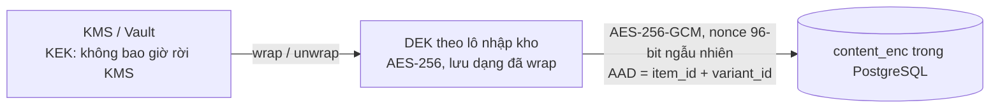

# 07. Bảo mật

Sàn MMO là mục tiêu tấn công hấp dẫn vì có **tiền thật** (số dư ví) và **hàng số đổi được ra tiền ngay** (tài khoản, key). Kẻ tấn công thường là người trong ngành, rành kỹ thuật. Thiết kế bảo mật theo nguyên tắc:

- **Phòng thủ nhiều lớp**: một lớp hỏng thì lớp khác vẫn chặn.
- **Đặc quyền tối thiểu**: người, dịch vụ và tài khoản DB chỉ có đúng quyền cần dùng.
- **Mặc định từ chối**: không có quy tắc cho phép thì chặn.
- **Không tin client**: giá, số dư, quyền, trạng thái luôn kiểm tra ở server.
- **Mọi thứ đều để lại dấu vết**: hành động quan trọng đều có log không sửa được.

Chuẩn tham chiếu: **OWASP ASVS 4.0 mức 2** (mức 3 cho module ví/thanh toán), OWASP Top 10, OWASP API Security Top 10.

---

## 1. Xác thực (Authentication)

| Hạng mục | Thiết kế |
|---------|---------|
| Băm mật khẩu | **argon2id** (m=64MB, t=3, p=1), có pepper lưu ngoài DB (KMS/biến môi trường bí mật) |
| Chính sách mật khẩu | Tối thiểu 10 ký tự, không bắt ký tự đặc biệt rườm rà. **Chặn mật khẩu đã lộ** qua HIBP k-anonymity (chỉ gửi 5 ký tự đầu của SHA-1). Chặn mật khẩu chứa email/username |
| 2FA | TOTP (RFC 6238), cửa sổ ±1 bước, **chống dùng lại mã** (lưu bước thời gian đã dùng). 10 mã khôi phục băm riêng. **Bắt buộc** với seller và nhân sự. Bật mặc định khuyến khích người mua (banner + ưu đãi) |
| Passkey (P3) | WebAuthn. **Bắt buộc khoá cứng (YubiKey) cho Super Admin và Finance** |
| Chống dò mật khẩu | Rate limit theo IP (10/phút) **và** theo tài khoản (5 lần sai thì khoá tăng dần: 1, 5, 15, 60 phút). Sau 3 lần sai thì yêu cầu Turnstile. Thông báo lỗi chung "Sai thông tin đăng nhập" |
| Chống credential stuffing | Cloudflare Bot Management / rule WAF. Phát hiện 1 IP thử nhiều tài khoản thì chặn IP. Cảnh báo khi tỷ lệ đăng nhập lỗi toàn sàn tăng đột biến |
| Không lộ tài khoản tồn tại | Đăng ký, quên mật khẩu trả cùng một thông điệp và cùng thời gian phản hồi |
| Phiên đăng nhập | **Session phía server** lưu Redis + bảng `sessions`. Cookie `__Host-sid`: `HttpOnly; Secure; SameSite=Lax; Path=/`. Token 256-bit ngẫu nhiên, DB chỉ lưu **hash**. Hết hạn trượt 7 ngày (người mua), 12 giờ (seller center), **30 phút không hoạt động, tối đa 8 giờ (admin)** |
| Xoay phiên | Tạo session ID mới khi đăng nhập, khi qua 2FA, khi đổi quyền (chống session fixation) |
| Thu hồi | Đổi mật khẩu, bật/tắt 2FA, đổi email thì thu hồi mọi phiên khác. Người dùng tự xem và đăng xuất từng thiết bị |
| Xác thực lại (step-up) | Yêu cầu 2FA (và PIN) trong 10 phút gần nhất khi: rút tiền, thêm/xoá ngân hàng, đổi email/mật khẩu, tắt 2FA, tạo API key, mua đơn > ngưỡng, xem lại hàng đã mua sau 24h (tuỳ chọn) |
| Cảnh báo | Email + thông báo khi: đăng nhập thiết bị/quốc gia mới, đổi mật khẩu, đổi 2FA, thêm ngân hàng, tạo lệnh rút. Có link "Không phải tôi" để khoá ngay tài khoản |
| Đặt lại mật khẩu | Token 1 lần, 15 phút, chỉ lưu hash. Đặt lại xong **khoá rút tiền 24 giờ** (chống chiếm tài khoản rồi rút ngay) |
| Đổi email | Xác nhận ở **cả email cũ và mới**. Khoá rút 48 giờ |
| Khôi phục khi mất 2FA | Không tự động. Gửi yêu cầu kèm xác minh danh tính (KYC cho seller), nhân sự duyệt, 2 người phê duyệt, chờ 72 giờ, thông báo qua email cũ |

## 2. Phân quyền (Authorization)

**Hai lớp kiểm tra cho mọi request:**
1. **RBAC theo permission**: `@RequirePermission('withdrawal.approve')`, áp dụng cho nhân sự.
2. **Policy theo quyền sở hữu (ABAC)**: tài nguyên có thuộc người này không? Ví dụ seller chỉ sửa sản phẩm có `store.owner_id = currentUser`, người mua chỉ xem đơn có `buyer_id = currentUser`.

**Chống IDOR (lỗi phổ biến nhất ở các sàn):**
- Mọi truy vấn tài nguyên của người dùng **luôn có điều kiện sở hữu trong câu WHERE**, ví dụ `findFirst({ where: { code, buyerId: user.id } })`. Không lấy theo ID rồi mới kiểm tra.
- Dùng UUIDv7 / mã ngẫu nhiên, không dùng ID tăng dần.
- Không có quyền thì trả **404**, không trả 403, để không lộ tài nguyên có tồn tại.
- Có bộ **test tự động phân quyền**: mỗi endpoint có test "user B truy cập tài nguyên của user A thì bị từ chối".

**Chống mass assignment:** DTO Zod whitelist từng field. Không bao giờ `update(req.body)`. Các field `status`, `level`, `fee`, `balance`, `role` không bao giờ nhận từ client của người dùng.

**Bảng quyền nhân sự (ví dụ):**

| Permission | Support | Mod | Finance | Admin | Super |
|-----------|:------:|:---:|:------:|:----:|:----:|
| `user.view` | ✔ | ✔ | ✔ | ✔ | ✔ |
| `user.lock` | | ✔ | | ✔ | ✔ |
| `user.mfa_reset` (2 người) | | | | ✔ | ✔ |
| `kyc.view` | | | | ✔ | ✔ |
| `product.moderate` | | ✔ | | ✔ | ✔ |
| `dispute.resolve` (≤ 2 triệu) | ✔ | | | ✔ | ✔ |
| `dispute.resolve` (> 2 triệu) | | | | ✔ | ✔ |
| `stock.view_content` (cần lý do) | | | | ✔ | ✔ |
| `deposit.manual_match` | | | ✔ | | ✔ |
| `withdrawal.approve` / `withdrawal.mark_paid` | | | ✔ | | ✔ |
| `ledger.adjust` (2 người) | | | ✔ (tạo) | | ✔ (duyệt) |
| `settings.manage`, `iam.manage`, `kill_switch` | | | | | ✔ |

**Nguyên tắc 4 mắt (two-person rule):** điều chỉnh số dư, reset 2FA, rút tiền lớn, nạp tay lớn, đổi cấu hình phí. Người tạo và người duyệt phải khác nhau (ràng buộc ở DB và ứng dụng).

## 3. Bảo vệ tiền và giao dịch

| Rủi ro | Biện pháp |
|-------|-----------|
| **Race condition** chi tiêu 2 lần (gửi 50 request mua đồng thời) | Transaction + `SELECT … FOR UPDATE` trên tài khoản ví. `CHECK (balance >= 0)` ở DB làm chốt chặn cuối. Test bắt buộc: bắn 100 request song song thì số dư không âm và tổng khớp |
| Bán trùng 1 item | `FOR UPDATE SKIP LOCKED` + `UNIQUE(content_hmac)` |
| Gửi lại request (replay) | `Idempotency-Key` bắt buộc. Lưu kết quả 24 giờ, cùng key khác payload thì trả 422 |
| Sửa giá phía client | Server luôn tính lại giá từ DB. Client chỉ gửi `variantId`, `qty` |
| Số âm / tràn số | Validate `qty` là số nguyên 1..max, `amount` > 0 và ≤ hạn mức. Dùng `bigint` |
| **Webhook giả** cộng tiền | HMAC trên raw body (constant-time compare), timestamp ±5 phút, IP allowlist, unique `provider_txn_id`, số tiền lấy từ webhook (không lấy từ deposit) |
| Sai lệch sổ sách | Sổ cái kép bất biến (không UPDATE/DELETE), job `ledger.verify` hằng đêm, đối soát với sao kê ngân hàng thật. Lệch 1 đồng cũng báo động và có thể tự bật kill-switch rút tiền |
| Chiếm tài khoản rồi rút tiền | Step-up 2FA + PIN, khoá rút sau khi đổi mật khẩu/email/ngân hàng, chỉ rút về ngân hàng **trùng tên KYC**, email xác nhận lệnh rút |
| Rửa tiền / dùng sàn làm trung gian | Gắn cờ: nạp rồi rút mà không giao dịch, nhiều tài khoản rút về cùng 1 ngân hàng, giao dịch vòng giữa 2 tài khoản. Chỉ cho rút số tiền bán hàng (seller), không cho rút số dư nạp vào khi chưa dùng (cấu hình) |
| Gian lận nội bộ | 4 mắt, phân tách quyền (người duyệt ≠ người chi), audit log chuỗi hash, báo cáo hằng ngày gửi chủ sàn về mọi điều chỉnh thủ công |
| Lạm dụng mã giảm giá / giới thiệu | Giới hạn theo user + thiết bị + IP + ngân hàng. Phát hiện tự giới thiệu. Thưởng giới thiệu chỉ trả sau khi đơn hoàn tất |
| Seller lừa đảo bỏ trốn | Escrow + thời gian giữ theo cấp + hạn mức rút. Tỷ lệ khiếu nại cao thì tự động tăng hold và khoá rút chờ xem xét |

## 4. Bảo vệ hàng số (tài khoản, key) và dữ liệu nhạy cảm

**Envelope encryption cho `stock_items.content_enc`:**

- Mỗi lô nhập kho dùng 1 DEK (data encryption key). DEK được wrap bởi KEK nằm trong KMS. DB chỉ chứa DEK đã wrap.
- **AAD** (dữ liệu xác thực bổ sung) gắn `item_id` + `variant_id`. Ai đó copy ciphertext sang dòng khác thì giải mã sẽ thất bại.
- DEK đã unwrap được cache trong RAM tối đa 5 phút, không ghi ra đĩa hay log.
- **Chỉ giải mã khi:** người mua của đơn đó xem hàng, hoặc admin có quyền `stock.view_content` + nhập lý do (audit). Seller chỉ thấy bản che (`abc***@gmail.com|****`) sau khi nhập.
- Xoay khoá: KEK xoay hằng năm (rewrap DEK, không cần mã hoá lại dữ liệu). Nghi lộ thì xoay DEK và mã hoá lại bằng job.
- `content_hmac` = HMAC-SHA256(pepper riêng, nội dung chuẩn hoá) để kiểm tra trùng mà không cần giải mã.
- Sau N ngày kể từ khi đơn hoàn tất (ví dụ 90 ngày, hiển thị rõ cho người mua), có thể xoá nội dung để giảm rủi ro nếu bị lộ (chỉ giữ hash).

**Dữ liệu khác được mã hoá ở tầng ứng dụng:** TOTP secret, số tài khoản ngân hàng, dữ liệu người mua điền cho đơn dịch vụ, ảnh KYC (mã hoá trước khi upload hoặc bật SSE-KMS trên bucket).

**Mã hoá đường truyền và lưu trữ:** TLS 1.2+ ở mọi chặng (kể cả nội bộ app ↔ DB). Ổ đĩa DB và backup được mã hoá.

## 5. Bảo mật ứng dụng web

| Lỗ hổng | Biện pháp |
|--------|-----------|
| **SQL Injection** | Prisma (tham số hoá). Raw SQL chỉ qua `$queryRaw` tagged template, **cấm `$queryRawUnsafe`** (rule ESLint/Semgrep chặn ở CI) |
| **XSS** | React tự escape. Nội dung người dùng (mô tả sản phẩm, bài, bình luận, chat) lưu Markdown, render server-side bằng `markdown-it` (tắt HTML) rồi **DOMPurify** allowlist (b, i, ul, ol, li, a, code, pre, img từ domain của sàn). Cấm `dangerouslySetInnerHTML` ngoài component sanitize duy nhất |
| CSP | `default-src 'self'; script-src 'self' 'nonce-…' 'strict-dynamic' https://challenges.cloudflare.com; img-src 'self' https://cdn.mmomarket.vn data:; connect-src 'self' wss://mmomarket.vn; frame-ancestors 'none'; base-uri 'none'; form-action 'self'; object-src 'none'`. Bật `report-to` để thu thập vi phạm |
| **CSRF** | SameSite=Lax + CSRF token (double-submit, gắn theo phiên) + kiểm tra `Origin`/`Sec-Fetch-Site` cho mọi request thay đổi dữ liệu |
| Clickjacking | `frame-ancestors 'none'` + `X-Frame-Options: DENY` |
| Header bảo mật khác | `Strict-Transport-Security: max-age=63072000; includeSubDomains; preload`, `X-Content-Type-Options: nosniff`, `Referrer-Policy: strict-origin-when-cross-origin`, `Permissions-Policy: camera=(), microphone=(), geolocation=()`, `Cross-Origin-Opener-Policy: same-origin` |
| CORS | Chỉ cho origin của chính sàn. Admin API không bật CORS cho web công khai |
| **SSRF** | Không fetch URL do người dùng nhập. Nếu cần preview link: chạy ở worker riêng, chặn IP nội bộ/metadata (169.254.169.254, 10.0.0.0/8…), timeout ngắn |
| Open redirect | Tham số `?next=` chỉ nhận đường dẫn tương đối nằm trong allowlist |
| Link ngoài | `rel="nofollow ugc noopener noreferrer"` + trang trung gian "Bạn sắp rời MMO Market" kèm cảnh báo lừa đảo |
| Lộ thông tin | Tắt stack trace ở production, header `X-Powered-By` bị gỡ, thông báo lỗi chung kèm `requestId` |
| Validation | Zod cho mọi input (độ dài, kiểu, khoảng giá trị, enum). Giới hạn body 1MB (trừ upload qua presigned URL) |
| Deserialization / Prototype pollution | Không merge object từ client bằng deep-merge, dùng `Object.create(null)` khi cần map động |
| ReDoS | Regex từ khoá cấm dùng engine RE2 hoặc giới hạn thời gian |

## 6. Upload file

1. Client xin **presigned URL** (PUT, hết hạn 5 phút, giới hạn `Content-Length` và `Content-Type`), upload thẳng lên bucket **quarantine**.
2. Worker kiểm tra: magic bytes đúng loại khai báo, kích thước, **quét ClamAV**, ảnh thì **re-encode bằng sharp** (xoá EXIF/GPS, loại payload ẩn), giới hạn số pixel (chống decompression bomb).
3. Đạt thì chuyển sang bucket đích, tên file ngẫu nhiên (không dùng tên gốc trong đường dẫn).
4. **Không nhận SVG, HTML** từ người dùng. Chỉ nhận ảnh JPG/PNG/WebP/GIF, file `.txt/.csv` (kho), PDF/ZIP (bằng chứng, chỉ trong bucket private).
5. Ảnh công khai phục vụ từ **domain riêng** (`cdn.mmomarket-usercontent.vn`) để cookie không gửi kèm và tránh XSS cùng origin. File private phục vụ qua signed URL 60 giây, header `Content-Disposition: attachment`.

## 7. Chống lạm dụng, spam và lừa đảo

| Hành vi | Giới hạn mặc định (cấu hình được) |
|--------|-------------------------------|
| Đăng ký | 3 tài khoản / IP / ngày, Turnstile bắt buộc |
| Đăng nhập | 10 / IP / phút, 5 sai / tài khoản rồi khoá tăng dần |
| Quên mật khẩu, gửi lại email | 3 / tài khoản / giờ |
| Tạo đơn | 30 / người / phút |
| Đăng bài yêu cầu | Tài khoản < 7 ngày: 2 / ngày + duyệt bài đầu. Bình thường: 10 / ngày |
| Bình luận | 10 / phút, 200 / ngày. Tài khoản mới không được chèn link |
| Tin nhắn | 20 / 10 giây, tối đa 30 hội thoại **mới** / ngày với tài khoản < 30 ngày (chống spam quảng cáo) |
| Báo giá | 50 / ngày |
| Tìm kiếm | 60 / phút / IP |
| Upload | 100 file / giờ |

- **Rate limit 2 tầng**: Cloudflare (theo IP, ở biên) và ứng dụng (Redis sliding window, theo user + IP + route).
- **Bộ lọc nội dung**: từ khoá cấm (hàng cấm, lừa đảo), phát hiện SĐT/Zalo/Telegram/link rút gọn trong chat và bình luận thì cảnh báo hoặc che, phát hiện spam lặp nội dung.
- **Phát hiện đa tài khoản**: fingerprint thiết bị (băm), IP, ngân hàng, CCCD. Mục đích: phát hiện tự đánh giá, tự giới thiệu, né khoá.
- **Cảnh báo lừa đảo hiển thị cố định**: trên khung chat, trang nạp tiền, trang rút tiền: *"Sàn chỉ nhận tiền qua tài khoản ngân hàng hiển thị trên trang nạp. Không giao dịch ngoài sàn."*
- **Chống giả mạo nhân viên**: tài khoản nhân sự có huy hiệu xác thực không làm giả được (render từ role ở server). Chặn đăng ký username chứa "admin", "hotro", "support", "mod"…

## 8. Bảo mật chat

- Chỉ thành viên hội thoại đọc/gửi được. Server tự đẩy vào room `user:{id}`, client không tự join room tuỳ ý.
- Xác thực socket bằng cookie phiên + kiểm tra `Origin`. Phiên bị thu hồi thì ngắt socket ngay (pub/sub sự kiện `session.revoked`).
- **Không mã hoá đầu cuối (E2E)**: sàn cần đọc được tin nhắn làm bằng chứng khi khiếu nại và để phát hiện lừa đảo. Bù lại: mã hoá đường truyền, mã hoá ổ đĩa, **nhân sự chỉ xem được hội thoại khi có khiếu nại/báo cáo liên quan** (gắn với `dispute_id`/`report_id`, ghi audit). Điều này được nêu rõ trong Chính sách bảo mật.
- Nội dung tin nhắn render dạng text thuần (không Markdown/HTML), link tự nhận diện nhưng đi qua trang cảnh báo.

## 9. Bảo mật khu vực Admin

- **Ứng dụng tách riêng**, domain riêng `admin.mmomarket.vn`, cookie riêng, không chung session với web.
- **Chỉ truy cập qua Cloudflare Access (Zero Trust) hoặc VPN WireGuard** + IP allowlist. Người ngoài không thấy được cả trang đăng nhập.
- Bắt buộc 2FA, khuyến nghị bắt buộc passkey/khoá cứng cho Finance và Super Admin.
- Phiên ngắn (30 phút không hoạt động). Hành động nhạy cảm yêu cầu step-up và **nhập lý do**.
- Không dùng chung tài khoản. Nghỉ việc thì vô hiệu hoá ngay (checklist offboarding).
- Dữ liệu nhạy cảm (email, SĐT, số tài khoản) **che mặc định** trong bảng, bấm "Hiện" mới xem và hành động đó được ghi log.
- Xuất dữ liệu (export CSV) cần quyền riêng, có watermark người xuất, ghi log.
- Dashboard **"Hoạt động nhân sự"**: ai làm gì, cảnh báo bất thường (xem quá nhiều nội dung kho, điều chỉnh số dư ngoài giờ).

## 10. Nhật ký, giám sát và cảnh báo

**Audit log** (bảng `audit_logs`, append-only, chuỗi hash): mọi thao tác của nhân sự, mọi thay đổi quan trọng của người dùng (bảo mật tài khoản, ngân hàng, rút tiền), mọi lần giải mã hàng số. App DB user **không có quyền UPDATE/DELETE**. Bản sao đẩy sang kho log riêng (Loki/S3 với Object Lock) để chống xoá dấu vết.

**Không log**: mật khẩu, token, mã 2FA, nội dung hàng số, số tài khoản đầy đủ, cookie. Sentry bật scrubbing.

**Cảnh báo tự động (gửi Telegram/email nhóm vận hành):**

| Sự kiện | Ngưỡng ví dụ | Mức |
|--------|--------------|-----|
| Chữ ký webhook sai | ≥ 1 | Cao |
| Sổ cái lệch | ≥ 1 đồng | Khẩn cấp (có thể tự tắt rút tiền) |
| Đăng nhập lỗi toàn sàn | > 5× trung bình 1 giờ | Cao |
| Đăng nhập admin từ IP/thiết bị mới | ≥ 1 | Cao |
| Điều chỉnh số dư thủ công | Mọi lần | Trung bình (báo chủ sàn) |
| Lệnh rút lớn | > 50 triệu | Trung bình |
| Tỷ lệ lỗi 5xx | > 1% trong 5 phút | Cao |
| Một tài khoản xem > N item kho / giờ | N = 500 | Cao |
| Số lần gọi `stock.view_content` của admin | > 10 / ngày / người | Trung bình |

## 11. Hạ tầng và chuỗi cung ứng

| Hạng mục | Biện pháp |
|---------|-----------|
| Mạng | Máy chủ trong private network. Chỉ Cloudflare vào được (Tunnel hoặc firewall chỉ nhận dải IP Cloudflare). DB, Redis, Meilisearch **không có IP public** |
| SSH | Chỉ khoá, tắt đăng nhập root và mật khẩu, qua bastion/VPN, fail2ban. Hoặc dùng Tailscale/Teleport |
| Hệ điều hành | Tự động cập nhật bản vá bảo mật (unattended-upgrades), CIS benchmark cơ bản |
| Container | Image tối giản (distroless/alpine), chạy user không phải root, filesystem read-only, quét Trivy ở CI |
| DB | Tài khoản DB riêng cho từng vai trò: `app_rw` (không DROP/ALTER, không UPDATE/DELETE bảng sổ cái/audit), `migrator` (chỉ dùng khi deploy), `readonly_report`. Bật `pgaudit` cho thao tác DDL |
| Redis | Bật AUTH + ACL, `rename-command` FLUSHALL/CONFIG, không public |
| Bí mật | Không commit `.env`. Dùng Doppler/Vault/SOPS. Xoay khoá API định kỳ. **gitleaks** quét ở CI và pre-commit |
| Phụ thuộc | Renovate/Dependabot, `pnpm audit` chặn lỗ hổng high/critical, khoá phiên bản (lockfile), xem xét package mới trước khi thêm |
| SAST/DAST | CodeQL + Semgrep (rule tuỳ chỉnh: cấm `queryRawUnsafe`, cấm `dangerouslySetInnerHTML`, bắt buộc guard trên controller), OWASP ZAP baseline scan trên staging mỗi tuần |
| DDoS | Cloudflare. Bật "Under Attack mode" khi cần, rate limit biên, cache trang công khai |
| Sao lưu | Mã hoá, khác nhà cung cấp, Object Lock (bất biến) chống ransomware, khôi phục thử hằng tuần |

## 12. Quyền riêng tư dữ liệu cá nhân

- Thu thập tối thiểu: người mua chỉ cần email. KYC chỉ với seller.
- Có văn bản đồng ý xử lý dữ liệu, chính sách bảo mật rõ ràng, mục đích sử dụng, thời gian lưu.
- Quyền của chủ thể dữ liệu: xem, tải về, sửa, xoá (xoá tài khoản thì ẩn danh hoá dữ liệu cá nhân, giữ dữ liệu giao dịch theo nghĩa vụ kế toán/thuế).
- Thời gian lưu: ảnh KYC lưu đến khi đóng gian hàng + thời hạn luật định, sau đó xoá. Log đăng nhập 12 tháng.
- Tuân thủ quy định bảo vệ dữ liệu cá nhân hiện hành của Việt Nam (xem [10 – Pháp lý](./10-phap-ly-va-van-hanh.md)), bao gồm thông báo khi có vi phạm dữ liệu.

## 13. Kế hoạch ứng phó sự cố

**Công tắc khẩn cấp (kill-switch)**, chỉ Super Admin, có hiệu lực ngay:
- Tạm dừng **rút tiền** toàn sàn.
- Tạm dừng **đặt hàng** / **nạp tiền** / **đăng ký** / **chat**.
- Chế độ **bảo trì** (chỉ đọc).
- **Đăng xuất toàn bộ** người dùng (xoá mọi session) hoặc toàn bộ nhân sự.
- **Đóng băng** một tài khoản/gian hàng (khoá rút, ẩn sản phẩm, giữ escrow).

**Quy trình (playbook):**
1. **Phát hiện**: cảnh báo tự động / báo cáo người dùng. Ghi nhận thời điểm.
2. **Khoanh vùng**: bật kill-switch phù hợp, thu hồi khoá/token nghi lộ, chặn IP.
3. **Điều tra**: audit log, log ứng dụng, sổ cái. Giữ nguyên bằng chứng (snapshot).
4. **Khắc phục**: vá lỗi, xoay khoá, khôi phục dữ liệu, hoàn tiền người bị ảnh hưởng từ quỹ dự phòng.
5. **Thông báo**: người dùng bị ảnh hưởng và cơ quan chức năng theo thời hạn luật định.
6. **Rút kinh nghiệm**: báo cáo sau sự cố (postmortem), bổ sung test và cảnh báo.

Duy trì **quỹ dự phòng rủi ro** (ví dụ % doanh thu phí) để bồi hoàn khi có sự cố.

## 14. Checklist bảo mật trước khi ra mắt

- [ ] Toàn bộ endpoint có test phân quyền (IDOR) tự động.
- [ ] Test race condition: mua song song, rút song song, nạp webhook trùng.
- [ ] Sổ cái: bất biến kiểm tra pass trên dữ liệu load test.
- [ ] 2FA bắt buộc với seller và nhân sự đã bật.
- [ ] Admin chỉ truy cập qua Access/VPN, đã thử truy cập từ IP lạ và bị chặn.
- [ ] CSP, HSTS, cookie flags đạt điểm A trên securityheaders.com và Mozilla Observatory.
- [ ] Không còn secret trong repo (gitleaks toàn bộ lịch sử).
- [ ] Không lỗ hổng high/critical từ `pnpm audit`, Trivy, CodeQL.
- [ ] Backup khôi phục thử thành công, đo RTO.
- [ ] Kill-switch đã thử trên staging.
- [ ] **Pentest bởi bên thứ ba độc lập** (tập trung: ví, đơn hàng, IDOR, webhook, upload, admin), đã sửa toàn bộ lỗi high/critical.
- [ ] Chương trình **bug bounty** nhỏ (hoặc kênh `security@` + `security.txt`) sẵn sàng nhận báo cáo.
- [ ] Nhân sự đã được đào tạo nhận diện lừa đảo/social engineering.
