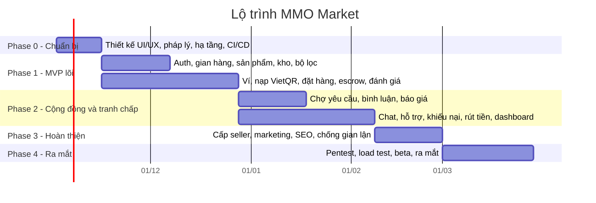

# Kế hoạch thiết kế: Sàn giao dịch sản phẩm MMO

> Tên dự án tạm gọi: **MMO Market**. Đổi tên thương hiệu sau khi chốt domain.

Đây là bộ tài liệu kế hoạch cho một sàn thương mại điện tử nhiều người bán (multi-vendor), chuyên về sản phẩm và dịch vụ MMO (Make Money Online). Tài liệu đủ để đội dev, thiết kế và vận hành bắt tay vào làm.

## Yêu cầu gốc

| # | Yêu cầu | Đáp ứng tại |
|---|---------|-------------|
| 1 | Nhiều người có thể mở gian hàng, đăng bán sản phẩm | [02 – Chức năng §B, §C](./02-chuc-nang.md) |
| 2 | Khu đăng bài yêu cầu (cần tìm gì), bình luận, trả lời bình luận | [02 – Chức năng §I](./02-chuc-nang.md), [03 – Luồng §8](./03-luong-nghiep-vu.md) |
| 3 | Phân danh mục và loại sản phẩm, bộ lọc trực quan | [02 – Chức năng §D](./02-chuc-nang.md), [08 – Giao diện §3](./08-giao-dien-va-dashboard.md) |
| 4 | Nhắn tin trực tiếp với người bán, nhắn hỗ trợ với admin | [02 – Chức năng §J](./02-chuc-nang.md), [04 – Kiến trúc §5](./04-kien-truc-cong-nghe.md) |
| 5 | Bảo mật đầy đủ | [07 – Bảo mật](./07-bao-mat.md) |
| 6 | Trang admin trực quan, dễ nhìn | [08 – Giao diện §6](./08-giao-dien-va-dashboard.md) |
| 7 | Trang người bán trực quan, dễ nhìn | [08 – Giao diện §5](./08-giao-dien-va-dashboard.md) |

## Mục lục

1. [Tổng quan, phạm vi và mô hình kinh doanh](./01-tong-quan.md)
2. [Danh sách chức năng theo module](./02-chuc-nang.md)
3. [Luồng nghiệp vụ (đặt hàng, ký quỹ, khiếu nại, nạp/rút, bài yêu cầu)](./03-luong-nghiep-vu.md)
4. [Kiến trúc và công nghệ](./04-kien-truc-cong-nghe.md)
5. [Thiết kế cơ sở dữ liệu](./05-co-so-du-lieu.md)
6. [Thiết kế API và sự kiện realtime](./06-api.md)
7. [Bảo mật](./07-bao-mat.md)
8. [Giao diện, bộ lọc, dashboard seller và admin](./08-giao-dien-va-dashboard.md)
9. [Lộ trình, nhân sự, chi phí, kiểm thử](./09-lo-trinh.md)
10. [Pháp lý và vận hành](./10-phap-ly-va-van-hanh.md)

## Các quyết định chính (tóm tắt)

| Chủ đề | Quyết định | Lý do ngắn |
|--------|-----------|------------|
| Mô hình giao dịch | **Ký quỹ trung gian (escrow)**: tiền người mua được sàn giữ, chỉ trả cho người bán sau thời gian bảo hành không có khiếu nại | Hàng MMO là hàng số, dễ lừa đảo. Escrow là cách chính để giữ niềm tin |
| Thanh toán | Số dư nội bộ + nạp qua chuyển khoản VietQR, xác nhận tự động bằng webhook của cổng có giấy phép | Phù hợp thói quen người dùng Việt, xác nhận tức thì |
| Giao hàng | 2 kiểu: **tự động** (kho hàng số, giao ngay khi thanh toán) và **thủ công** (dịch vụ, có hạn giao) | Bao phủ cả tài khoản, key, tool lẫn dịch vụ |
| Kiến trúc | **Modular monolith** (NestJS) + Next.js, PostgreSQL, Redis, Meilisearch | Đội nhỏ làm nhanh, tách service sau khi cần |
| Admin | Ứng dụng **tách riêng**, subdomain riêng, giới hạn IP/VPN, bắt buộc 2FA | Giảm bề mặt tấn công vào khu vực nhạy cảm nhất |
| Dữ liệu hàng số | **Mã hoá từng bản ghi** (AES-256-GCM, envelope encryption), chỉ giải mã khi giao cho người mua | Lộ DB cũng không lộ tài khoản/key đang bán |
| Sổ cái tiền | **Bút toán kép (double-entry)**, không bao giờ sửa/xoá, đối soát hằng ngày | Chống sai lệch số dư, chống gian lận nội bộ |
| Nhắn tin | Socket.IO + Redis, lưu Postgres. Không mã hoá đầu cuối, vì cần kiểm duyệt khi có tranh chấp | Cần bằng chứng để xử lý khiếu nại |

## Lộ trình tổng thể (≈ 21 tuần)

Chi tiết từng giai đoạn: [09 – Lộ trình](./09-lo-trinh.md).
